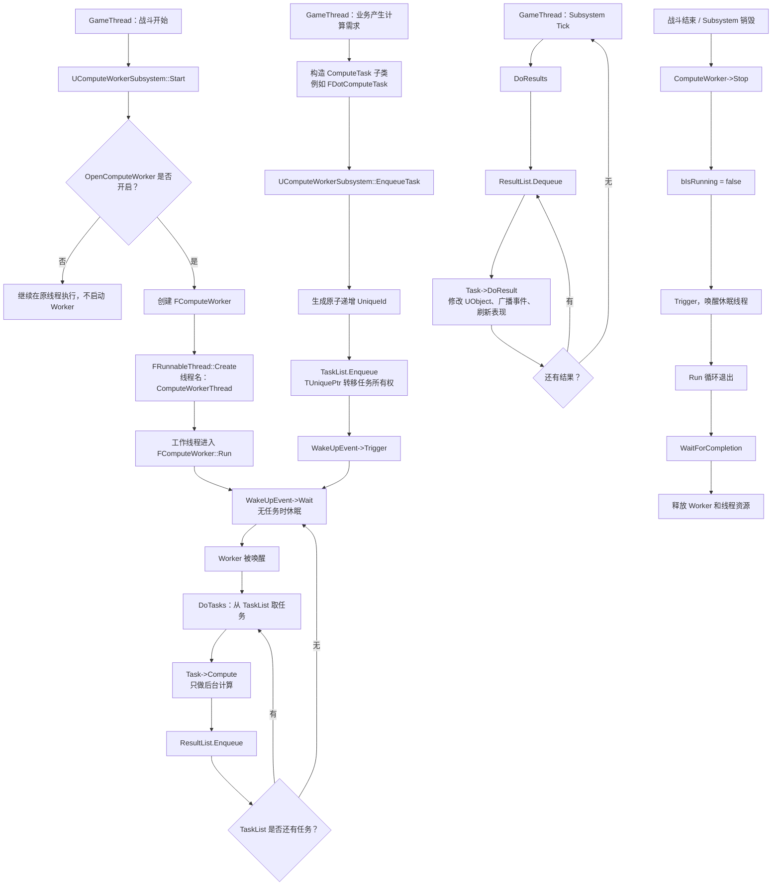
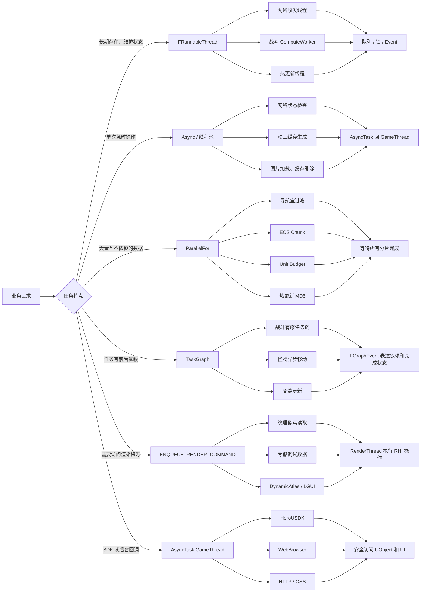
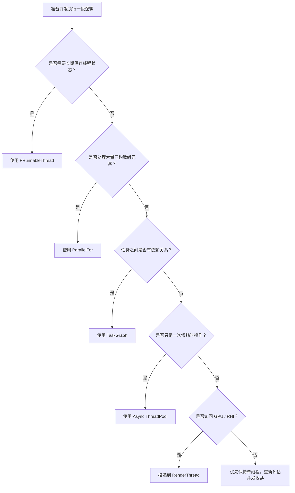

# 定位项目多线程代码

> 分析当前项目中，使用多线程的地方有哪些。注意是项目中，而不是引擎中。

<details><summary>6 previous messages</summary>

> 我会只扫描项目自身的源码与配置，明确排除引擎目录、第三方库和生成目录；先按代码中的线程创建、线程池/异步任务、并行循环与线程同步几条线索交叉检索，再逐处确认实际用途。由于这是代码库分析，我先加载仓库工作规范与必用的技能说明。
>
> <details><summary>Called a tool</summary>
>
> MCP tool call
>
> node_repl.js
>
> ```json
> {
>   "code": "var fsA = await import('node:fs/promises'); var skillTextA = await fsA.readFile('C:/Users/yongkang.guo/.codex/superpowers/skills/using-superpowers/SKILL.md','utf8'); nodeRepl.write(skillTextA);",
>   "title": "读取必用技能说明"
> }
> ```
>
> Error: js execution timed out; kernel reset, rerun your request
>
> </details>
>
> 本地终端会话初始化异常（连最小只读命令也未返回）；我正在绕过该会话层继续读取项目，不会因此扩大到引擎源码。接下来先确认仓库根目录和项目模块边界，再给出带文件与行号的结论。
>
> <details><summary>Called a tool</summary>
>
> MCP tool call
>
> codex_apps.github.search_installed_repositories_v2
>
> ```json
> {
>   "query": "EM",
>   "limit": 20,
>   "include_search_index_status": true
> }
> ```
>
> ```text
> Action completed.
> ```
>
> ```json
> {
>   "repositories": []
> }
> ```
>
> </details>
>
> 已确认不是代码检索本身慢，而是当前 `F:` 工作卷对目录元数据访问也持续阻塞；连 `Source` 是否存在这样的只读检查都无法完成。我会再做一次不递归的底层目录访问验证；若仍失败，我不会猜测项目中的多线程点，会把可复现的阻塞信息和恢复后可直接执行的扫描范围交代清楚。
>
> 项目边界已确认：这是 `EM.uproject`，我会纳入 `Source/`、项目自带 `Plugins/`、`Script/`、`Tools/` 等项目代码，排除 `Binaries/`、`Intermediate/`、`DerivedDataCache/`、`Saved/`、插件内 `ThirdParty/` 及任何引擎源码。现在开始按“创建/调度线程、跨线程投递、并行执行、同步原语、其他语言线程库”分类核实。
</details>

已完成扫描。范围限定为 `F:\Pan1\demo\EM` 项目自身的 `Source/` 和项目内 `Plugins/`，排除了引擎、`Intermediate`、`Binaries`、`Saved`、第三方 SDK 源码、Python 运行时和 `node_modules`。

## 主项目源码中的多线程

| 模块 | 线程方式 | 用途与入口 |
|---|---|---|
| 网络收发 | 独立 `FRunnableThread` | 客户端创建 `EM Client Net Thread`，服务器使用 ForkableThread；线程循环处理连接事件、收包、发包。[NetworkManager.cpp](./Source/EM/Private/Client/NetworkManager.cpp:72)、[NetThreadRunnable.cpp](./Source/EM/Private/Client/NetThreadRunnable.cpp:22)、[NetThreadRunnable.h](./Source/EM/Public/Client/NetThreadRunnable.h:30) |
| 战斗计算 | 独立 `ComputeWorkerThread` | 使用 SPSC 任务/结果队列和 `FEvent` 唤醒，处理伤害、Buff、区域同步、交互、战斗成就等计算。[ComputeWorkerSubsystem.cpp](./Source/EM/Private/Combat/Common/ComputeWorkerSubsystem.cpp:53)、[ComputeWorker.cpp](./Source/EM/Private/Combat/Common/ComputeWorker.cpp:44) |
| 战斗 TaskGraph 模式 | `TGraphTask` | `UseTaskGraphDamageCompute` 开启后，支持有序依赖链、无序并行和帧末批处理；计算在线程池执行，结果切回 GameThread。[ComputeTaskManager.h](./Source/EM/Public/Combat/Common/ComputeTaskManager.h:74)、[ComputeTaskManager.cpp](./Source/EM/Private/Combat/Common/ComputeTaskManager.cpp:25)、[TaskGraphComputeTask.cpp](./Source/EM/Private/Combat/Common/TaskGraphComputeTask.cpp:8) |
| 热更新 | 临时 `FRunnableThread` + `ParallelFor` | 分别创建 `TryDiffAsset`、`VerifyAssets`、`RealPersistent` 线程；客户端并行计算文件 MD5，服务器强制单线程。[HotUpdateSubsystem.h](./Source/EM/Public/Manager/HotUpdate/HotUpdateSubsystem.h:95)、[HotUpdateSubsystem.cpp](./Source/EM/Private/Manager/HotUpdate/HotUpdateSubsystem.cpp:1633)、[HotUpdateSubsystem.cpp](./Source/EM/Private/Manager/HotUpdate/HotUpdateSubsystem.cpp:2491) |
| 动画缓存生成 | `FAutoDeleteAsyncTask` | 后台采样动画空间 Transform、RootMotion，完成后切回 GameThread 合并缓存。[AnimOptGameInstanceSubsystem.h](./Source/EM/Public/Common/AnimOptGameInstanceSubsystem.h:710)、[AnimOptGameInstanceSubsystem.cpp](./Source/EM/Private/Common/AnimOptGameInstanceSubsystem.cpp:853) |
| 怪物异步移动 | 高优先级 TaskGraph | `FMovementCalculationTask` 运行于 `AnyBackgroundHiPriTask`，计算角色移动模拟结果。[CharacterMovementComponentAsync.h](./Source/EM/Public/Char/CharacterMovementComponentAsync.h:671)、[MonCharMoveComp.cpp](./Source/EM/Private/Char/MonsterComp/MonCharMoveComp.cpp:790) |
| 骨骼物理更新 | TaskGraph AnyThread | 并行执行运动学骨骼更新。[MonSkeletalMeshComponent.cpp](./Source/EM/Private/Char/MonsterComp/MonSkeletalMeshComponent.cpp:21)、[MonSkeletalMeshComponent.cpp](./Source/EM/Private/Char/MonsterComp/MonSkeletalMeshComponent.cpp:234) |
| 网络状态检测 | 公共线程池 | 定时在线程池调用平台 Wi-Fi 检测，用三个原子变量防止任务堆积和析构竞争，结果回到 GameThread。[NetworkMonitorSubsystem.cpp](./Source/EM/Private/Manager/NetworkMonitorSubsystem.cpp:47)、[NetworkMonitorSubsystem.h](./Source/EM/Public/Manager/NetworkMonitorSubsystem.h:33) |
| 本地纹理加载 | `AsyncTask(AnyThread)` | 后台读取图片文件，随后切回 GameThread 设置 Texture。[TextureProxy.cpp](./Source/EM/Private/Common/TextureProxy.cpp:10) |
| 愚人节缓存清理 | `AsyncTask(AnyThread)` | 后台枚举和删除缓存图片。[FoolsDaySubsystem.cpp](./Source/EM/Private/Story/Subsystems/FoolsDaySubsystem.cpp:152) |
| 编辑器阴影检查 | 多个独立线程 | 按 `ThreadCount` 拆分 Actor，通过 `Async(EAsyncExecution::Thread)` 并行做包围盒及射线检测，然后等待全部线程。[EditorCommonFunctionLibrary.cpp](./Source/EMEditor/Private/Common/EditorCommonFunctionLibrary.cpp:990) |

### `ParallelFor` 使用点

项目源码中有 7 个当前生效的 `ParallelFor` 调用：

- 导航旋转盒覆盖过滤：[EMRecastNavMesh.cpp](./Source/EM/Private/AI/EMRecastNavMesh.cpp:2410)
- Significance 队列对象 Tick：[SignifanceQueueManager.cpp](./Source/EM/Private/Manager/SignifanceQueueManager.cpp:109)
- ECS 按 Chunk 执行查询：[ECSEntityManager.cpp](./Source/EM/Private/Manager/ECS/ECSEntityManager.cpp:481)
- Unit Budget 两轮并行更新：[UnitBudgetAllocatorSubsystem.cpp](./Source/EM/Private/Common/UnitBudgetAllocatorSubsystem.cpp:2340)
- 动画 Transform 拆分，可由 `bUseParallelForInMakeTransforms` 控制：[AnimOptGameInstanceSubsystem.cpp](./Source/EM/Private/Common/AnimOptGameInstanceSubsystem.cpp:1691)
- 热更新文件 MD5 校验：[HotUpdateSubsystem.cpp](./Source/EM/Private/Manager/HotUpdate/HotUpdateSubsystem.cpp:2484)

### 游戏线程、渲染线程之间的投递

这些不是新建线程，但属于明确的跨线程逻辑：

- Texture 像素读取投递到 RenderThread，再回到 GameThread：[TextureLibrary.h](./Source/EM/Public/Common/TextureLibrary.h:63)
- 怪物骨骼调试物理数据投递到 RenderThread：[MonSkeletalMeshComponent.cpp](./Source/EM/Private/Char/MonsterComp/MonSkeletalMeshComponent.cpp:854)
- Niagara SpawnProxy 通过 MPSC 队列和五组 `FRWLock` 跨线程交换粒子变量：[NiagaraDataInterface_SpawnProxy.h](./Source/EM/Public/Combat/NiagaraDataInterface/NiagaraDataInterface_SpawnProxy.h:113)
- HeroUSDK 回调大量切回 GameThread：`HeroUsdkSupportNotifyImpl.cpp` 有 34 处，Market 回调有 4 处。
- WebBrowser、后台 HTTP、OSS 上传、CloudGame 回调也会切回 GameThread。

## 项目插件中的多线程

这些代码位于项目 `Plugins/`，不是引擎源码；其中大部分被 `EM.Build.cs` 或 `EMEditor.Build.cs` 引用：

- `ACE_SDK`：各平台创建 `ACESDKNetworkThread`。[ACESDKWindows.cpp](./Plugins/ACE_SDK/Source/ACE_SDK/Private/Windows/ACESDKWindows.cpp:27)
- `HeroNewBDCPlugin`：为埋点/上报创建多个低优先级 Worker。[BdcAsyncTrackManager.cpp](./Plugins/HeroNewBDCPlugin/Source/HeroNewBDCPlugin/Private/Platform/Utils/BdcAsyncTrackManager.cpp:61)
- `FMODStudio`：创建 `FMOD File Access Coordinator` 文件访问线程。[FMODFileCallbacks.cpp](./Plugins/FMODStudio/Source/FMODStudio/Private/FMODFileCallbacks.cpp:62)
- `UnLua`：Lua 死循环检测线程；编辑器工具还使用 ThreadPool。[LuaDeadLoopCheck.cpp](./Plugins/UnLua/Source/UnLua/Private/LuaDeadLoopCheck.cpp:42)
- `UnrealClaude`：编辑器 MCP 任务队列线程和 Claude 进程读取线程。[MCPTaskQueue.cpp](./Plugins/UnrealClaude/Source/UnrealClaude/Private/MCP/MCPTaskQueue.cpp:45)、[ClaudeCodeRunner.cpp](./Plugins/UnrealClaude/Source/UnrealClaude/Private/ClaudeCodeRunner.cpp:240)
- `HotPatcher`：通用 `FThreadWorker`，并大量使用 `ParallelFor` 解析资产、Cook、处理 Pak。[FThreadUtils.hpp](./Plugins/HotPatcher/Source/HotPatcherCore/Public/ThreadUtils/FThreadUtils.hpp:22)
- `KawaiiPhysics`：按物理链 `ParallelFor`。[AnimNode_KawaiiPhysicsParallel.cpp](./Plugins/KawaiiPhysics/Source/KawaiiPhysics/Private/AnimNode_KawaiiPhysicsParallel.cpp:326)
- `DynamicAtlas`、`LGUI`：大量通过 `ENQUEUE_RENDER_COMMAND` 更新纹理、字体、网格和后处理。
- `GameAutoPlugin` 虽然包含 Socket 接收线程，但在 `EM.uproject` 中明确 `Enabled: false`，未计入当前启用逻辑。
- `UESVON` 定义了异步寻路任务，但实际 `StartBackgroundTask` 调用目前是注释状态，未计入生效点。

## 建议优先检查的线程安全问题

1. Niagara Color/Vec3 写入使用了错误的锁：写 `ColorVariables` 和 `Vec3Variables` 时锁的是 `IntVariablesLock`，而读取端分别锁 `ColorVariablesLock`、`Vec3VariablesLock`，无法形成互斥。[NiagaraDataInterface_SpawnProxy.cpp](./Source/EM/Private/Combat/NiagaraDataInterface/NiagaraDataInterface_SpawnProxy.cpp:393)

2. 网络线程的 `bStopSign`、计算线程的 `bIsRunning` 都是普通 `bool`，由主线程写、工作线程读，属于数据竞争；应使用原子变量或同步机制。[NetThreadRunnable.h](./Source/EM/Public/Client/NetThreadRunnable.h:75)、[ComputeWorker.h](./Source/EM/Public/Combat/Common/ComputeWorker.h:35)

3. 导航 `ParallelFor` 中多个迭代会交叉读写 `IsContained[j]`，当前没有同步，存在数据竞争。[EMRecastNavMesh.cpp](./Source/EM/Private/AI/EMRecastNavMesh.cpp:2406)

4. 编辑器阴影检查在线程中直接访问 `AActor`、组件和 `UKismetSystemLibrary::LineTraceSingle`，需要确认这些 UObject/World/Physics 接口是否允许从工作线程调用。[EditorCommonFunctionLibrary.cpp](./Source/EMEditor/Private/Common/EditorCommonFunctionLibrary.cpp:995)

5. 动画缓存后台任务直接读取 `USkeletalMeshComponent`、`UAnimSequence` 并调用其方法；弱指针只能解决生命周期判断，不能自动保证 UObject 的线程安全。[AnimOptGameInstanceSubsystem.cpp](./Source/EM/Private/Common/AnimOptGameInstanceSubsystem.cpp:48)

6. `TextureProxy` 和 `FoolsDaySubsystem` 的后台 Lambda 捕获原始 `this`，对象销毁时存在悬空访问窗口，建议改为 `TWeakObjectPtr` 并避免在后台读取 UObject 成员。

> 以上使用到线程方式，请你举个案例，并总结项目中的使用流程或者说是调用方式（以流程图的形式展示出来），我的目的是想通过项目中的这些地方，来学习多线程技术。

<details><summary>1 previous message</summary>

> 我会以项目里最完整的 `ComputeWorkerThread` 为主案例，再把 `FRunnableThread`、TaskGraph、线程池、`ParallelFor`、RenderThread 投递放进一张总览流程图，帮助你看清“什么时候创建线程、怎么传任务、怎么把结果送回主线程”。由于你明确要求流程图，我会使用可视化技能来组织图示，并严格以项目现有代码为依据。
</details>

最适合学习的案例是项目里的 `ComputeWorkerThread`：它完整覆盖了线程创建、任务封装、线程安全队列、事件唤醒、后台计算、结果回主线程以及线程退出。

## 案例：战斗计算线程

主要代码：

- 线程管理：[ComputeWorkerSubsystem.cpp](./Source/EM/Private/Combat/Common/ComputeWorkerSubsystem.cpp:53)
- Worker 实现：[ComputeWorker.cpp](./Source/EM/Private/Combat/Common/ComputeWorker.cpp:44)
- Worker 定义：[ComputeWorker.h](./Source/EM/Public/Combat/Common/ComputeWorker.h:18)
- 任务抽象：[ComputeTask.h](./Source/EM/Public/Combat/Common/ComputeTask.h:82)
- 一个调用案例：[DotBuff.cpp](./Source/EM/Private/Combat/Buff/Component/DotBuff.cpp:830)

### 完整调用流程



### 这个设计最重要的思想

任务被拆成了两部分：

```cpp
class ComputeTask
{
public:
    // 工作线程执行：纯计算
    virtual void Compute(FComputeWorker* Worker) {}

    // GameThread 执行：应用计算结果
    virtual void DoResult() {}
};
```

调用者以 Dot Buff 为例：

```cpp
auto Task = FDotComputeTask::ConstructDotComputeTask(...);
ComputeWorkerSubsystem->EnqueueTask(MoveTemp(Task));
```

实际经过：

```text
GameThread
    创建任务
       ↓
TaskList（SPSC）
       ↓
ComputeWorkerThread
    Compute()
       ↓
ResultList（SPSC）
       ↓
GameThread Tick
    DoResult()
```

这种设计解决了三个问题：

- `TUniquePtr` 转移任务所有权，避免两个线程同时管理同一个任务。
- `FEvent` 让线程没有任务时休眠，避免空循环占用 CPU。
- `Compute()` 和 `DoResult()` 分离，后台线程不直接修改大多数 UObject。

## 项目中各种线程方式的总流程



## 各种方式应该怎么学习

| 方式 | 项目案例 | 适用场景 | 核心知识 |
|---|---|---|---|
| `FRunnableThread` | [NetworkManager.cpp](./Source/EM/Private/Client/NetworkManager.cpp:72) | 长生命周期、需要内部状态或阻塞等待 | `Init/Run/Stop`、线程生命周期、Event |
| 生产者/消费者队列 | [ComputeWorker.h](./Source/EM/Public/Combat/Common/ComputeWorker.h:38) | 主线程持续产生任务，后台线程消费 | SPSC/MPSC、所有权转移 |
| `Async(ThreadPool)` | [NetworkMonitorSubsystem.cpp](./Source/EM/Private/Manager/NetworkMonitorSubsystem.cpp:63) | 偶发、短时间、无长期状态的任务 | 公共线程池、原子变量、弱引用 |
| `FAutoDeleteAsyncTask` | [AnimOptGameInstanceSubsystem.cpp](./Source/EM/Private/Common/AnimOptGameInstanceSubsystem.cpp:853) | 自包含的后台计算任务 | `FNonAbandonableTask`、自动销毁 |
| `ParallelFor` | [EMRecastNavMesh.cpp](./Source/EM/Private/AI/EMRecastNavMesh.cpp:2410) | 数组元素可独立处理 | 数据分片、避免共享写 |
| `TGraphTask` | [ComputeTaskManager.h](./Source/EM/Public/Combat/Common/ComputeTaskManager.h:74) | 任务之间存在依赖或顺序要求 | prerequisite、`FGraphEventRef` |
| `ENQUEUE_RENDER_COMMAND` | [TextureLibrary.h](./Source/EM/Public/Common/TextureLibrary.h:63) | 操作 RHI、GPU 或 RenderProxy | GameThread/RenderThread 边界 |
| `AsyncTask(GameThread)` | [TaskGraphComputeTask.cpp](./Source/EM/Private/Combat/Common/TaskGraphComputeTask.cpp:60) | 后台计算结束后更新 UObject/UI | 跨线程回调、对象生命周期 |

## 选择线程方式的简单规则



## 学习时必须注意的边界

1. `Compute()` 里尽量只处理普通数据、副本和线程专用数据；不要随意调用 Actor、Component、World 等 UObject 接口。

2. UObject、UI、Delegate 广播等结果操作放到 `DoResult()`，确保在 GameThread 执行。

3. 当前 `TaskList` 和 `ResultList` 是 `EQueueMode::Spsc`，意味着分别只能有一个生产者、一个消费者。如果未来允许多个线程调用 `EnqueueTask()`，需要改成 MPSC 或增加同步。

4. `FEvent` 的典型停止顺序是：

```text
设置退出标志 → Trigger 唤醒 → Run 退出 → WaitForCompletion → 释放对象
```

5. 项目中的 `bIsRunning` 和网络线程的 `bStopSign` 目前是普通 `bool`。从标准 C++ 内存模型看，跨线程读写应改为原子变量，这是学习该案例时需要识别的一个现存缺陷。

建议学习顺序为：`NetworkMonitor Async` → `ParallelFor` → `ComputeWorker` → `TaskGraph` → `RenderThread`。其中 `ComputeWorker` 是理解项目整个多线程架构的核心案例。

> 关于线程安全队列，也就是共享数据相关的内容。例如：工作线程执行完毕的结果，GameThread线程如何使用。这种线程之间的衔接，请你再详细说明下。举个例子，并说出相关的注意事项

<details><summary>1 previous message</summary>

> 我会继续沿用 `ComputeWorkerThread → ResultList → GameThread::DoResult` 这条真实链路，重点说明三件事：数据所有权如何转移、队列怎样形成线程间可见性、以及 UObject 为什么只能在结果阶段处理。还会结合一个实际的 Dot Buff 任务，把容易出现的数据竞争和生命周期问题标出来。
</details>

这里最关键的不是“两个线程共享同一份可变数据”，而是“数据所有权在两个线程之间来回转移”。

项目的 `ComputeWorker` 正是这种比较安全的设计：

```text
GameThread 拥有任务
    ↓ MoveTemp
工作线程拥有任务
    ↓ Compute，写入结果
    ↓ MoveTemp
GameThread 重新拥有任务
    ↓ DoResult，应用结果
```

## 具体案例：Dot Buff 后台计算

任务定义中同时携带输入和输出：

- 输入快照：`FDotComputeInfo`
- 计算结果：`FDotComputeResult`
- 主线程对象引用：`TWeakObjectPtr<ABattle>`

参见 [DotComputeTask.h](./Source/EM/Public/Combat/Buff/ComputeThreadLogic/DotComputeTask.h:27)。

### 线程衔接流程

```mermaid
flowchart LR
    subgraph GT1["GameThread：提交阶段"]
        A["读取 UBuff、Actor、属性等 UObject 数据"]
        B["复制为 FDotComputeInfo<br/>纯数值输入快照"]
        C["创建 TUniquePtr&lt;FDotComputeTask&gt;"]
        D["TaskList.Enqueue<br/>MoveTemp 转移所有权"]
        E["WakeUpEvent->Trigger"]
    end

    subgraph Q1["TaskList：SPSC"]
        F["生产者：GameThread<br/>消费者：ComputeWorkerThread"]
    end

    subgraph WT["ComputeWorkerThread：计算阶段"]
        G["WakeUpEvent->Wait 返回"]
        H["TaskList.Dequeue"]
        I["工作线程独占 Task"]
        J["Task->Compute"]
        K["生成 FDotComputeResult<br/>只写任务内部结果"]
        L["ResultList.Enqueue<br/>再次转移所有权"]
    end

    subgraph Q2["ResultList：SPSC"]
        M["生产者：ComputeWorkerThread<br/>消费者：GameThread"]
    end

    subgraph GT2["GameThread：结果阶段"]
        N["Subsystem::Tick"]
        O["ResultList.Dequeue"]
        P["GameThread 独占 Task"]
        Q["Task->DoResult"]
        R["重新查找 Battle / Character"]
        S["修改 Buff、伤害、护盾和表现"]
        T["TUniquePtr 析构，释放任务"]
    end

    A --> B --> C --> D --> F
    F --> H
    E --> G --> H
    H --> I --> J --> K --> L --> M
    M --> O
    N --> O --> P --> Q --> R --> S --> T
```



## 第一阶段：GameThread 制作输入快照

Dot Buff 调用处：

```cpp
auto Task = FDotComputeTask::ConstructDotComputeTask(
    Buff,
    FreeLayer,
    EDotTaskType::DotTask_AddFreeLayer);

ComputeWorkerSubsystem->EnqueueTask(MoveTemp(Task));
```

见 [DotBuff.cpp](./Source/EM/Private/Combat/Buff/Component/DotBuff.cpp:830)。

构造任务时，项目没有简单地把 `UBuff*` 交给工作线程，而是先把需要的数据复制出来：

```cpp
BuffObjId
TaskBuffId
TargetEid
SourceEid
SourceSkillId
Value
Layer
SkillLevel
SourceSkillIntensity
SourceSkillSustain
SourceSkillEfficiency
PerLayerDotInfos
```

相关实现在 [DotComputeInfo.cpp](./Source/EM/Private/Combat/Buff/ComputeThreadLogic/DotComputeInfo.cpp:11)。

这里的重点是：

```text
错误方式：
工作线程直接读取 BuffObj->Owner->GetAttr()

项目采用的方式：
GameThread 先读取 BuffObj
        ↓
复制成普通 int/float/数组
        ↓
工作线程只读取这些副本
```

这叫输入快照。快照创建完成后，即使 GameThread 上的 Buff 属性发生改变，工作线程也不会和 GameThread 同时读写同一个 UObject。

代价是：工作线程看到的是“任务提交时的数据”，而不是最新数据。

## 第二阶段：任务所有权转给工作线程

任务队列定义为：

```cpp
TQueue<TUniquePtr<ComputeTask>, EQueueMode::Spsc> TaskList;
TQueue<TUniquePtr<ComputeTask>, EQueueMode::Spsc> ResultList;
```

见 [ComputeWorker.h](./Source/EM/Public/Combat/Common/ComputeWorker.h:38)。

提交代码：

```cpp
Task->SetUniqueId();
ComputeWorker->EnqueueTask(MoveTemp(Task));
ComputeWorker->TriggerWakeUp();
```

见 [ComputeWorkerSubsystem.cpp](./Source/EM/Private/Combat/Common/ComputeWorkerSubsystem.cpp:321)。

执行 `MoveTemp(Task)` 后：

```cpp
TUniquePtr<ComputeTask> Task;
Queue.Enqueue(MoveTemp(Task));

// 此后 Task 已经是 nullptr
// GameThread 不能继续访问原任务
```

这一步非常重要。它避免了：

```text
GameThread 正在修改 Task
            ↕
WorkerThread 同时读取 Task
```

转移后，工作线程是该任务唯一的所有者。

### 队列和 Event 的职责不同

- `TQueue`：负责数据传递和线程同步。
- `FEvent`：负责把休眠中的线程唤醒。
- `FEvent` 本身不是任务容器。

正确顺序是：

```cpp
TaskList.Enqueue(MoveTemp(Task)); // 先发布数据
WakeUpEvent->Trigger();           // 再通知线程
```

不能反过来，否则工作线程可能先被唤醒，却暂时取不到任务。

## 第三阶段：工作线程独占计算

工作线程醒来后：

```cpp
while (TaskList.Dequeue(Task))
{
    Task->Compute(this);
    ResultList.Enqueue(MoveTemp(Task));
}
```

见 [ComputeWorker.cpp](./Source/EM/Private/Combat/Common/ComputeWorker.cpp:87)。

Dot 任务的 `Compute()`：

```cpp
void FDotComputeTask::Compute(FComputeWorker* ComputeWorker)
{
    switch (Type)
    {
    case EDotTaskType::DotTask_AddFreeLayer:
        AddLayerDotEffect(...);
        break;

    case EDotTaskType::DotTask_RemoveFreeLayer:
        RemoveLayerDotEffect(...);
        break;
    }

    // 计算过程会生成 DotComputeResult
}
```

见 [DotComputeTask.cpp](./Source/EM/Private/Combat/Buff/ComputeThreadLogic/DotComputeTask.cpp:59)。

计算输出主要是普通值：

```cpp
class FDotComputeResult
{
    int32 BuffId;
    int32 SourceSkillId;
    int32 TargetId;
    int32 DotIndex;
    TArray<FDotResultInfo> MergedFinalValues;
};
```

见 [DotComputeResult.h](./Source/EM/Public/Combat/Buff/ComputeThreadLogic/DotComputeResult.h:25)。

此时不需要为 `DotComputeResult` 单独加锁，因为：

1. GameThread 已经放弃了 Task 所有权。
2. 只有 WorkerThread 正在访问 Task。
3. Worker 完成后，把整个 Task 移入 `ResultList`。
4. 移入后 WorkerThread 不再访问它。

这是一种“所有权保证线程安全”的方式。

## 第四阶段：结果回到 GameThread

`UComputeWorkerSubsystem` 注册在 GameThread Tick：

```cpp
void UComputeWorkerSubsystem::Tick(float DeltaTime)
{
    DoResults();
}
```

消费结果：

```cpp
TUniquePtr<ComputeTask> Result;

while (ComputeWorker->ResultList.Dequeue(Result))
{
    Result->DoResult();
}
```

见 [ComputeWorkerSubsystem.cpp](./Source/EM/Private/Combat/Common/ComputeWorkerSubsystem.cpp:291)。

`ResultList.Dequeue()` 成功后，任务所有权重新回到 GameThread。

随后调用：

```cpp
void FDotComputeTask::DoResult()
{
    if (!Battle.IsValid())
    {
        return;
    }

    auto Target = Battle->GetEffectSource(DotComputeResult->TargetId);

    // 条件检查
    // 施加伤害
    // 回复生命
    // 添加护盾
    // 修改 SP
}
```

见 [DotComputeTask.cpp](./Source/EM/Private/Combat/Buff/ComputeThreadLogic/DotComputeTask.cpp:92)。

这里才允许：

- 查询 `ABattle`
- 获取 Character
- 调用 UObject 方法
- 修改 Buff、属性、护盾
- 广播 Delegate
- 创建表现或 UI

## 队列保证了什么

线程安全队列主要保证两件事：

### 1. 队列结构不会被并发破坏

一边 `Enqueue`，另一边 `Dequeue` 时，不会把链表节点、头尾指针等内部状态破坏掉。

### 2. 发布前的写入对消费者可见

工作线程执行：

```cpp
DotComputeResult->FinalValue = 100;
ResultList.Enqueue(MoveTemp(Task));
```

GameThread 成功 `Dequeue` 后，可以看到 `FinalValue == 100`。

概念上形成：

```text
Worker 写结果
    happens-before
Worker Enqueue
    synchronizes-with
GameThread Dequeue
    happens-before
GameThread 读结果
```

但需要注意：队列只保证“通过队列移交的数据”。

下面这种全局变量不会因为使用了队列就自动安全：

```cpp
// Worker
GlobalValue = 100;
ResultList.Enqueue(Task);

// 另一个无关线程
GlobalValue = 200;
```

如果对象仍被多个线程同时访问，仍然需要锁、原子变量或不可变设计。

## `Spsc` 的限制

项目使用的是：

```cpp
EQueueMode::Spsc
```

意思是：

```text
Single Producer
Single Consumer
```

对于 `TaskList`：

- 唯一生产者：GameThread
- 唯一消费者：ComputeWorkerThread

对于 `ResultList`：

- 唯一生产者：ComputeWorkerThread
- 唯一消费者：GameThread

这套结构成立的前提是所有 `EnqueueTask()` 都从 GameThread 调用。

如果以后 HTTP 回调、TaskGraph 或其他工作线程也调用：

```cpp
ComputeWorkerSubsystem->EnqueueTask(...);
```

就会变成多生产者，违反 SPSC 前提。此时应：

```cpp
TQueue<TaskType, EQueueMode::Mpsc>
```

或者把其他线程的提交先切回 GameThread。

## `ThreadSafe SharedPtr` 不等于对象线程安全

任务中有：

```cpp
TSharedPtr<FDotComputeResult, ESPMode::ThreadSafe> DotComputeResult;
```

`ESPMode::ThreadSafe` 只表示引用计数的增减是线程安全的。

它不表示下面这些字段可以并发修改：

```cpp
DotComputeResult->BuffId;
DotComputeResult->MergedFinalValues;
```

项目这里之所以不需要给字段加锁，是因为结果对象在任一时刻只有一个线程真正使用。

如果两个线程同时调用：

```cpp
DotComputeResult->MergedFinalValues.Add(...);
```

即使它是 `ThreadSafe SharedPtr`，仍然是数据竞争。

## 必须注意的几个问题

### 1. 结果可能已经过期

时间线可能是：

```text
Frame 100：提交任务，Buff 层数为 2
Frame 101：GameThread 将 Buff 层数改成 5
Frame 102：后台返回“基于层数 2”的结果
```

队列保证数据安全，但不保证业务结果仍然有效。

常见解决方案是为任务附加：

```cpp
EntityId
Generation
Version
RequestId
FrameNumber
```

`DoResult()` 时重新验证版本：

```cpp
if (CurrentVersion != ResultVersion)
{
    return; // 丢弃过期结果
}
```

### 2. 弱引用必须在结果阶段重新检查

项目保存了：

```cpp
TWeakObjectPtr<ABattle> Battle;
```

从提交到结果返回之间，Battle 可能已经销毁。因此 `DoResult()` 中重新调用 `Battle.IsValid()` 是必要的。

不能只在提交时检查一次。

### 3. 工作线程不要保存 UObject 裸指针

不推荐：

```cpp
class FTask
{
    UBuff* Buff;
};
```

推荐：

```cpp
class FTask
{
    // 后台计算输入
    FBuffInputSnapshot Input;

    // 回主线程时用于重新定位对象
    TWeakObjectPtr<UBuff> WeakBuff;
};
```

后台只访问 `Input`，GameThread 的 `DoResult()` 才访问 `WeakBuff`。

### 4. 退出时必须等待线程真正停止

安全退出顺序：


不能先清空 `ComputeWorker`，再等待线程，否则 Worker 可能正在访问已释放内存。

项目当前退出流程在 [ComputeWorkerSubsystem.cpp](./Source/EM/Private/Combat/Common/ComputeWorkerSubsystem.cpp:110)。

另外，`bIsRunning` 目前是普通 `bool`，由 GameThread 写、WorkerThread 读。更严谨的实现应该使用 `TAtomic<bool>` 或 `std::atomic<bool>`。

### 5. GameThread 消费结果也需要预算

当前代码每帧：

```cpp
while (ResultList.Dequeue(Result))
{
    Result->DoResult();
}
```

会一次性执行所有结果。若某帧积压几千个任务，GameThread 可能产生尖峰。

可以增加限制：

```cpp
int32 ProcessedCount = 0;
while (ProcessedCount < MaxResultsPerFrame &&
       ResultList.Dequeue(Result))
{
    Result->DoResult();
    ++ProcessedCount;
}
```

也可以使用时间预算，例如每帧最多处理 1 毫秒。

### 6. 队列可能无限增长

`TQueue` 通常没有业务容量限制。如果生产速度长期高于消费速度：

```text
GameThread 每帧提交 1000 个任务
Worker 每帧只能处理 300 个
```

队列会持续增长，造成延迟和内存压力。

需要考虑：

- 最大队列长度
- 合并同类任务
- 丢弃过期任务
- 生产者限流
- 监控 Queue Depth

## 推荐记住的安全模型

```text
不要尽量“共享并加锁”
优先“复制输入 + 转移所有权 + 返回结果”
```

对应项目模式：

```cpp
// GameThread
InputSnapshot = CopyFromUObject();
Task = MakeUnique<TaskType>(MoveTemp(InputSnapshot));
TaskQueue.Enqueue(MoveTemp(Task));

// WorkerThread
TaskQueue.Dequeue(Task);
Task->Compute();
ResultQueue.Enqueue(MoveTemp(Task));

// GameThread
ResultQueue.Dequeue(Task);
Task->DoResult();
```

这套模式的安全性来自四层：

1. 输入是 GameThread 创建的快照。
2. `TUniquePtr` 保证任一时刻只有一个所有者。
3. `TQueue` 完成线程间安全发布。
4. `DoResult()` 把 UObject 操作限制在 GameThread。

> [$ai-conversation-archive](C:/Users/yongkang.guo//.codex/skills/ai-conversation-archive/SKILL.md)

<details><summary>1 previous message</summary>

> System error
>
> unexpected status 401 Unauthorized: Incorrect API key provided: sk-d49b4*******************************************************fdd8. You can find your API key at https://platform.openai.com/account/api-keys., url: https://api.openai.com/v1/responses, cf-ray: a4b415035ba249ec-SJC, request id: req_33608751ac0e467196711fe54b083210, auth error: 401, auth error code: invalid_api_key
</details>

> [$ai-conversation-archive](C:/Users/yongkang.guo//.codex/skills/ai-conversation-archive/SKILL.md)

<details><summary>1 previous message</summary>

> System error
>
> unexpected status 401 Unauthorized: Missing bearer or basic authentication in header, url: https://api.openai.com/v1/responses, cf-ray: a4b4cf9e5fac98fc-SJC, request id: req_e810b1f165f0494a95ff9933f7edb46a
</details>

> [$ai-conversation-archive](C:/Users/yongkang.guo//.codex/skills/ai-conversation-archive/SKILL.md)

<details><summary>1 previous message</summary>

> System error
>
> unexpected status 401 Unauthorized: Missing bearer or basic authentication in header, url: https://api.openai.com/v1/responses, cf-ray: a4b4d2655967d4f9-SJC, request id: req_784410b7c5254cafb0437c7210b16040
</details>
