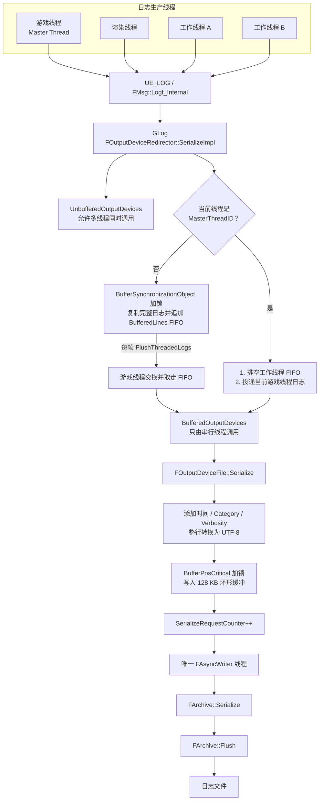
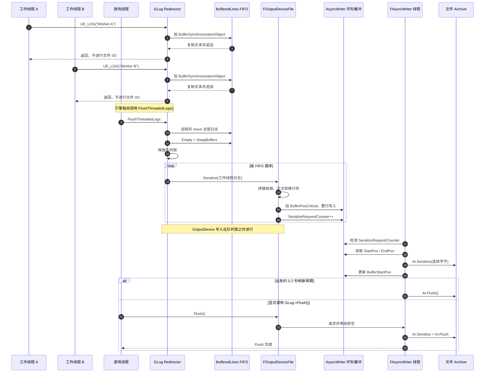
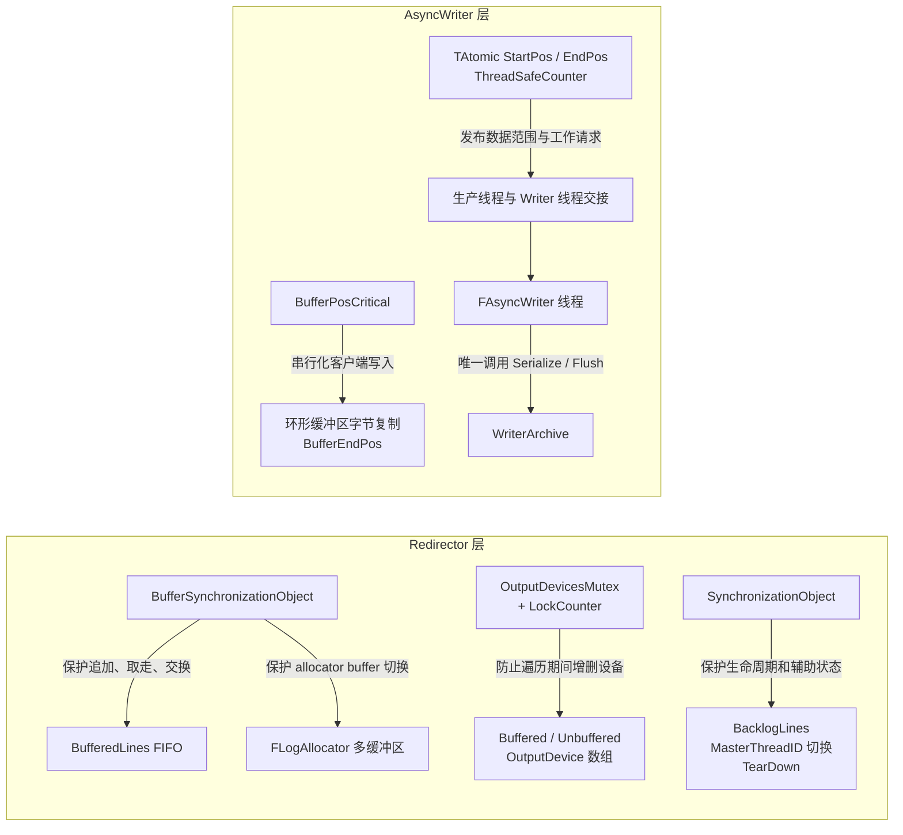
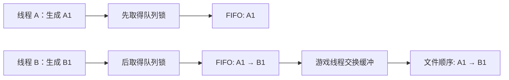
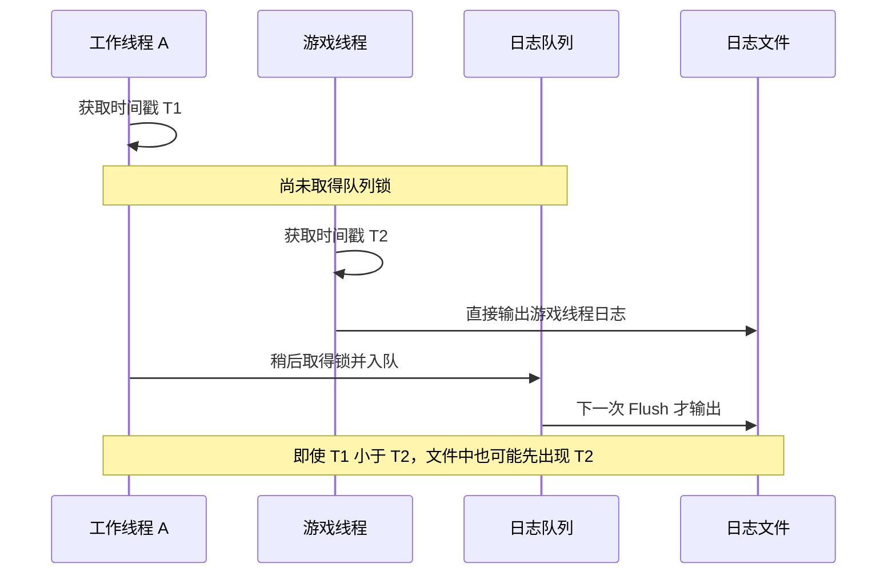
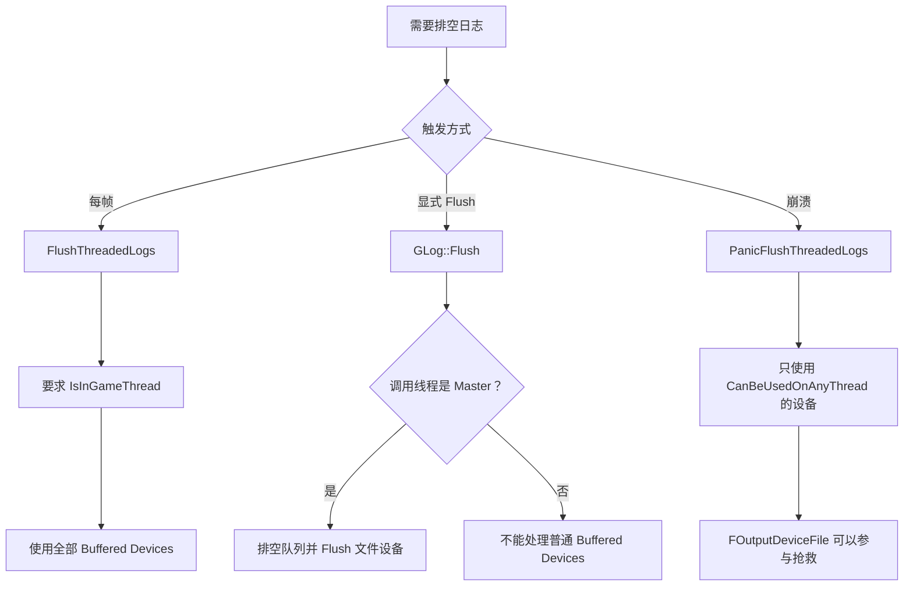

# 分析虚幻引擎日志线程模型

> 你来分析虚幻引擎的日志系统，是如何保证多个线程写，一个线程存盘的。

<details><summary>3 previous messages</summary>

> 我会沿着 UE4.27 的实际调用链做一次源码级分析，重点拆开“多线程产生日志”和“单线程落盘”之间的队列、锁、唤醒与刷盘机制。先用 `using-superpowers` 确认工作方式，再用 `openspec-explore` 组织这次只读调查，不改代码。
>
> `openspec-explore` 明确要求保持只读，因此这轮只追源码、不生成或修改任何实现文件。接下来我会先确认仓库中的 OpenSpec 上下文，再定位 `GLog`、`FOutputDeviceRedirector`、`FOutputDeviceFile` 以及日志线程相关实现。
>
> 已经确认仓库没有活动中的 OpenSpec change。源码显示这里其实有“两级单写者”结构：`GLog` 的 master thread 负责把跨线程日志串行投递给文件设备，而 `FOutputDeviceFile` 内部还有一个专用 `FAsyncWriter` 线程负责最终调用文件归档写入。我正在核对两级缓冲各自的锁粒度和顺序保证。
</details>

基于当前仓库的 UE 4.27.2 源码，结论是：

> UE 并不是让多个业务线程直接同时写日志文件，而是采用“两级缓冲 + 两个单写者阶段”：
> 多个线程先汇聚到 `GLog`，游戏线程负责串行投递；然后 `FAsyncWriter` 的专用线程独占执行真正的文件写入。

```text
工作线程 A ─┐
工作线程 B ─┼─> GLog / FOutputDeviceRedirector
渲染线程   ─┘          │
                       │ BufferSynchronizationObject
                       ▼
                BufferedLines FIFO
                       │
                       │ 游戏线程 Flush
                       ▼
              FOutputDeviceFile::Serialize
                       │
                       │ BufferPosCritical
                       ▼
               128 KB 环形字节缓冲区
                       │
                       │ 唯一 FAsyncWriter 线程
                       ▼
                FArchive -> 日志文件
```

## 第一层：多个线程汇聚到游戏线程

`GLog` 实际是全局单例 `FOutputDeviceRedirector`，记录一个 `MasterThreadID`。非主线程产生的日志进入 `BufferedLines` FIFO：

- 工作线程进入 `SerializeImpl()`。
- 如果当前线程不是 `MasterThreadID`，就在 `BufferSynchronizationObject` 锁内复制完整日志文本并追加到 `BufferedLines`。
- 工作线程随后立即返回，不访问日志文件设备。

对应源码：

- [`OutputDeviceRedirector.h:63`](./Engine/Source/Runtime/Core/Public/Misc/OutputDeviceRedirector.h:63)
- [`OutputDeviceRedirector.cpp:367`](./Engine/Source/Runtime/Core/Private/Misc/OutputDeviceRedirector.cpp:367)

核心判断是：

```cpp
if (CurrentThreadId != MasterThreadID)
{
    FScopeLock Lock(&BufferSynchronizationObject);
    new(BufferedLines) FBufferedLine(...);
}
```

日志内容会被复制，而不是保存调用者传进来的临时字符串指针，因此调用者返回后数据仍然有效。

游戏线程调用 `FlushThreadedLogs()` 时：

1. 在锁内把 `BufferedLines` move 到局部数组。
2. 清空并切换全局缓冲。
3. 立即释放锁。
4. 在锁外依次调用各个 OutputDevice 的 `Serialize()`。

这样工作线程只在“向 FIFO 追加”或“交换缓冲”时短暂等待，不会在磁盘写入期间持有这把锁。实现位于 [`OutputDeviceRedirector.cpp:205`](./Engine/Source/Runtime/Core/Private/Misc/OutputDeviceRedirector.cpp:205)。

正常引擎循环每帧都会由游戏线程主动排空一次：

[`LaunchEngineLoop.cpp:4738`](./Engine/Source/Runtime/Launch/Private/LaunchEngineLoop.cpp:4738)

此外，当游戏线程自己输出新日志时，它会先排空已有的工作线程日志，再输出自己的这一条，见 [`OutputDeviceRedirector.cpp:402`](./Engine/Source/Runtime/Core/Private/Misc/OutputDeviceRedirector.cpp:402)。

## 为什么文件设备不会被多个线程同时调用

注册 OutputDevice 时，Redirector 根据 `CanBeUsedOnMultipleThreads()` 分类：

- 返回 `true`：放入 `UnbufferedOutputDevices`，允许多个线程直接调用。
- 返回 `false`：放入 `BufferedOutputDevices`，普通工作线程只能排队。

分类代码在 [`OutputDeviceRedirector.cpp:124`](./Engine/Source/Runtime/Core/Private/Misc/OutputDeviceRedirector.cpp:124)。

`FOutputDeviceFile` 虽然声明 `CanBeUsedOnAnyThread() == true`，但没有声明 `CanBeUsedOnMultipleThreads() == true`，所以它仍然属于 Buffered Device：

[`OutputDeviceFile.h:128`](./Engine/Source/Runtime/Core/Public/Misc/OutputDeviceFile.h:128)

这两个概念不同：

- `CanBeUsedOnAnyThread`：可以由任意一个线程使用，主要服务于崩溃处理。
- `CanBeUsedOnMultipleThreads`：是否允许多个线程同时无锁调用。

所以正常情况下，只有 master/game thread 会进入 `FOutputDeviceFile::Serialize()`。

## 第二层：游戏线程也不直接写磁盘

`FOutputDeviceFile::Serialize()` 负责：

1. 加上时间、Category、Verbosity 前缀。
2. 转换成 UTF-8。
3. 把整行，包括换行符，合并成一次 `FAsyncWriter::Serialize()`。

源码：

- [`OutputDeviceFile.cpp:485`](./Engine/Source/Runtime/Core/Private/Misc/OutputDeviceFile.cpp:485)
- [`OutputDeviceHelper.cpp:66`](./Engine/Source/Runtime/Core/Private/Misc/OutputDeviceHelper.cpp:66)

`FAsyncWriter::Serialize()` 并不调用文件 API，而是在 `BufferPosCritical` 锁内把整行字节复制进一个初始大小为 128 KB 的环形缓冲区，然后增加 `SerializeRequestCounter`：

[`OutputDeviceFile.cpp:173`](./Engine/Source/Runtime/Core/Private/Misc/OutputDeviceFile.cpp:173)

真正写文件的是构造时创建的唯一线程：

```cpp
FRunnableThread::Create(this, "FAsyncWriter_xxx", ...);
```

见 [`OutputDeviceFile.cpp:144`](./Engine/Source/Runtime/Core/Private/Misc/OutputDeviceFile.cpp:144)。

这个线程轮询 `SerializeRequestCounter`，然后执行：

```cpp
Ar.Serialize(...);
Ar.Flush();
```

整个实现中，环形缓冲区到 `WriterArchive` 的写入只发生在 `FAsyncWriter::SerializeBufferToArchive()`：

[`OutputDeviceFile.cpp:64`](./Engine/Source/Runtime/Core/Private/Misc/OutputDeviceFile.cpp:64)

写线程循环位于 [`OutputDeviceFile.cpp:249`](./Engine/Source/Runtime/Core/Private/Misc/OutputDeviceFile.cpp:249)。

## 它具体保证了什么

- 不会同时写文件：只有一个 `FAsyncWriter` 线程调用底层 `FArchive::Serialize()`。
- 不会覆盖未写数据：环形缓冲空间不足时，生产者会等待 writer 排空；必要时扩容。
- 单条日志不会被拆散交错：前缀、正文、换行符合并后只进行一次环形缓冲写入。
- 同一线程内的日志顺序可以保持。
- 不同工作线程之间的顺序，以获得 `BufferSynchronizationObject` 锁并加入 FIFO 的顺序为准。
- OutputDevice 增删通过独立互斥量和引用计数保护，避免正在遍历设备时设备被移除。

但它不保证跨线程日志严格按照时间戳排序。例如工作线程已经取得时间戳、但尚未抢到队列锁时，游戏线程日志可能先进入文件。时间戳记录的是发生时间，文件行顺序反映的是并发汇聚顺序。

## Flush 与崩溃路径

默认情况下，writer 大约每 `0.2` 秒调用一次 `Ar.Flush()`；线程无工作时以 `10ms` 间隔轮询。配置位于 [`OutputDeviceFile.cpp:38`](./Engine/Source/Runtime/Core/Private/Misc/OutputDeviceFile.cpp:38)。

调用 `GLog->Flush()` 时会形成同步屏障：

1. 游戏线程排空 `BufferedLines`。
2. 文件设备调用 `FAsyncWriter::Flush()`。
3. 等待所有 serialize request 完成。
4. writer thread 执行 `Ar.Flush()`。

`-FORCELOGFLUSH` 可以让每行日志都执行一次完整 Flush，但性能成本会很高。

崩溃时使用 `PanicFlushThreadedLogs()`，允许崩溃线程排空那些声明 `CanBeUsedOnAnyThread()` 的设备，文件设备正是其中之一。不过源码对多个线程同时进入 panic/master 切换路径留有竞态警告，因此这是尽力抢救日志的降级路径，不具备正常运行路径同等强度的并发保证。

最后还有一个例外：如果平台不支持多线程，`FAsyncWriter` 不创建专用线程，而是在调用者线程同步写归档；仍是单写者，只是不再异步。

> [$openspec-explore](F://UE//MyUE_git//UE427//.codex//skills//openspec-explore//SKILL.md)
> 梳理下相关逻辑，以图的方式展示

<details><summary>1 previous message</summary>

> 我会继续保持 `openspec-explore` 的只读模式，把刚才确认的 UE4.27.2 源码调用链整理成图；同时使用 `visualize`，因为这次的交付重点就是让线程边界、缓冲层和刷盘时序一眼可见。不会改动引擎代码或 OpenSpec 文件。
</details>

基于 UE 4.27.2 源码，整个日志链路可以拆成两级生产者—消费者模型：

1. 多个业务线程 → 游戏线程串行投递 OutputDevice。
2. 游戏线程 → `FAsyncWriter` 专用线程串行写文件。

## 1. 总体架构图



其中 `FOutputDeviceFile` 属于 `BufferedOutputDevices`。因为它虽然返回 `CanBeUsedOnAnyThread() == true`，但没有返回 `CanBeUsedOnMultipleThreads() == true`，所以正常运行时不会被多个线程并发调用。

相关源码：

- [`OutputDeviceRedirector.cpp:124`](./Engine/Source/Runtime/Core/Private/Misc/OutputDeviceRedirector.cpp:124)
- [`OutputDeviceFile.h:128`](./Engine/Source/Runtime/Core/Public/Misc/OutputDeviceFile.h:128)

## 2. 多线程日志时序图

下面展示工作线程 A、工作线程 B、游戏线程几乎同时写日志时的正常流程：



游戏线程每帧触发排空的位置：

[`LaunchEngineLoop.cpp:4738`](./Engine/Source/Runtime/Launch/Private/LaunchEngineLoop.cpp:4738)

队列交换与排空实现：

[`OutputDeviceRedirector.cpp:205`](./Engine/Source/Runtime/Core/Private/Misc/OutputDeviceRedirector.cpp:205)

## 3. 锁与数据所有权



这里有几个关键设计点：

- `BufferSynchronizationObject` 只保护日志入队和队列交换，不覆盖后续 OutputDevice 处理，从而缩短工作线程等待时间。
- `BufferPosCritical` 保证即使特殊路径中有多个线程进入 `FAsyncWriter::Serialize()`，它们写环形缓冲时也不会互相覆盖。
- `BufferStartPos` 只由 writer thread 推进；`BufferEndPos` 在生产端发布。
- `SerializeRequestCounter` 既是工作通知，也是显式 Flush 时的完成条件。
- 底层 `WriterArchive` 只有 `FAsyncWriter` 线程访问，因此不需要让文件 Archive 自身支持并发写。

环形缓冲生产端代码：

[`OutputDeviceFile.cpp:173`](./Engine/Source/Runtime/Core/Private/Misc/OutputDeviceFile.cpp:173)

唯一的 Archive 写入代码：

[`OutputDeviceFile.cpp:73`](./Engine/Source/Runtime/Core/Private/Misc/OutputDeviceFile.cpp:73)

## 4. 日志顺序的真实语义



它保证的是：

- 同一线程内部顺序不变。
- 不同工作线程按照成功取得队列锁的顺序进入 FIFO。
- AsyncWriter 按环形缓冲中的字节顺序写文件。
- 单条日志作为一个 UTF-8 字节块进入环形缓冲，不会出现半行互相穿插。

它不保证跨线程日志严格按照时间戳排序：



因此日志文件中的行顺序是“并发汇聚顺序”，而不是全局时间排序。

## 5. 正常路径与异常路径



崩溃路径是尽力而为。源码对多个线程同时进入 panic flush 或同时切换 master thread 的情况留有竞态警告，因此不能把它视为和正常游戏线程路径完全相同的强保证。

一句话概括：

> `GLog` 的 FIFO 解决“谁来串行调用日志设备”，`FAsyncWriter` 的环形缓冲解决“谁来独占写文件”；两层共同完成多线程产生日志、单线程落盘。

> [$ai-conversation-archive](C:/Users/yongkang.guo//.codex/skills/ai-conversation-archive/SKILL.md)

<details><summary>1 previous message</summary>

> System error
>
> unexpected status 401 Unauthorized: Missing bearer or basic authentication in header, url: https://api.openai.com/v1/responses, cf-ray: a4b4cf2869aa6dd5-SJC, request id: req_9e09929ca304408092bea4555f4a894a
</details>

> [$ai-conversation-archive](C:/Users/yongkang.guo//.codex/skills/ai-conversation-archive/SKILL.md)

<details><summary>1 previous message</summary>

> System error
>
> unexpected status 401 Unauthorized: Missing bearer or basic authentication in header, url: https://api.openai.com/v1/responses, cf-ray: a4b4d062d9181986-SJC, request id: req_32cfaf3f36924bc9a339820718b56820
</details>
