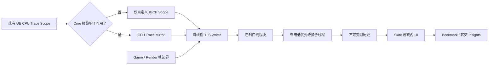

# 设计游戏内 CPU Profiler 原型

> Continuing from [图片来源查询](chatgpt-conversation://6a5f6b58-d6ec-83ee-9655-547ea8a3b1c5): 基于本地 Unreal Engine 源码路径 D:\UE\UE5_8，设计并后续实现一套游戏内 CPU Profiler 原型。第一阶段只输出原型设计：目标范围、模块划分、数据采集、线程安全缓冲、帧历史、UI 结构、与 Unreal Trace/Insights 的关系、里程碑和验证方案；暂不修改源码。

<details><summary>3 previous messages</summary>

> 我会先用“using-superpowers”确认本轮工作方式，再用“brainstorming”把原型边界和关键取舍收敛；随后只读检查 `D:\UE\UE5_8` 中与 Stats、Trace、TaskGraph 和游戏内调试 UI 相关的现有实现，最终给出一份能直接进入下一阶段开发的设计，不修改源码。
>
> 这两项技能现在把工作限定为“先调查、再设计、等待确认”：我不会进入实现，也不会生成或提交源码改动。先核对这份 UE 分支实际提供了哪些可复用设施，避免用通用 UE5 印象替代本地证据。
>
> 本地源码已经给出一个关键约束：现有 CPU Trace 的事件写入 `Core` 内部私有的线程局部压缩缓冲；Stats 虽然已有按帧历史和树形聚合，但其公开访问被限定在 Stats 线程，而且无法直接提供我们需要的精确墙钟时间线。原型是否允许增加一个极小的 Core 级分发点，会直接决定能否复用全引擎已有埋点。 我再核对这份分支版本和近期改动后，只需要确认这一项边界。
</details>

后续实现是否允许在 UE `Core` 中加入一个很小的采集分发钩子，以复用全引擎已有的 CPU Trace 埋点？如果不允许，我会把方案限定为完全独立的 Runtime 插件和专用埋点。

本轮仅做了只读检查，没有修改任何文件。

> 允许和不允许的方案，都进行阐述

<details><summary>1 previous message</summary>

> 我会把结果组织成三条路线：推荐的“极小 Core 钩子 + Runtime 插件”、完全不改 Core 的独立插件，以及“不改 Core 但在进程内解析 Trace”的重型路线。前两条都会展开到可实施的数据结构、缓冲交换、帧历史和 UI；第三条用于说明为什么原型阶段不推荐。仍然只读，不落源码改动。
</details>

结论：两种方案可以共享同一套插件架构、缓冲格式、帧历史和 UI。区别只在“事件从哪里来”。

我推荐最终采用：

> 独立 Runtime 插件作为主体 + Core 中一个极小的 CPU Trace 镜像钩子。

它既能复用全引擎已有的 `TRACE_CPUPROFILER_EVENT_SCOPE`，又不会把 TraceServices/Insights 的整套离线分析框架搬进游戏。若不允许修改 Core，则保留同样的后端与 UI，只能依赖自己的埋点，覆盖范围会明显缩小。

## 1. 本地源码调查结论

这份源码是 UE 5.8.0 分支。与设计直接相关的事实如下：

- `FCpuProfilerTrace` 已提供静态、动态、手动和带元数据的 CPU Scope；Shipping 默认关闭：[CpuProfilerTrace.h](D:/UE/UE5_8/Engine/Source/Runtime/Core/Public/ProfilingDebugging/CpuProfilerTrace.h:15)。
- CPU Trace 内部已有每线程 TLS 压缩缓冲，但缓冲及刷新逻辑是私有实现，无法由普通插件直接读取：[CpuProfilerTrace.cpp](D:/UE/UE5_8/Engine/Source/Runtime/Core/Private/ProfilingDebugging/CpuProfilerTrace.cpp:56)。
- Stats 已有帧历史、树形聚合和 Raw Packet，但 `FStatsThreadState::GetLocalState()` 明确只能在 Stats Thread 使用，不适合作为实时 UI 的直接数据源：[StatsData.h](D:/UE/UE5_8/Engine/Source/Runtime/Core/Public/Stats/StatsData.h:495)。
- Task Trace 已经记录 Created、Launched、Started、Finished、依赖和等待事件，可留给 Insights 做深度任务分析：[TaskTrace.cpp](D:/UE/UE5_5_8/Engine/Source/Runtime/Core/Private/Async/TaskTrace.cpp:14)。
- GameThread 和 RenderThread 均有现成帧边界委托：[CoreDelegates.h](D:/UE/UE5_8/Engine/Source/Runtime/Core/Public/Misc/CoreDelegates.h:277)。
- 游戏视口原生支持加入 Slate 调试工具层：[GameViewportClient.h](D:/UE/UE5_8/Engine/Source/Runtime/Engine/Classes/Engine/GameViewportClient.h:250)。

因此，直接“从现有 Trace 缓冲读取数据”没有干净的公开接口；Stats 能提供聚合但不适合精确线程时间线。原型最好拥有自己的实时缓冲。

## 2. 原型目标与范围

第一版解决五件事：

- 在 Development Editor、Development Game 和 Test Build 中实时开关。
- 显示 Game、Render、RHI、Task Worker 等线程上的嵌套 CPU Scope。
- 保留最近若干帧，支持暂停、选择和回看。
- 对选择帧生成按线程、调用层级和业务类别聚合的统计树。
- 发现问题后能转交 Unreal Insights 深挖。

第一版不做：

- GPU Pass 和 GPU 时间线。
- Context Switch、CPU Core 迁移、Ready/Running/Blocked。
- Task 依赖图和自动关键路径。
- Callers/Callees。
- 内存、加载、网络分析。
- 长时间录制、远程连接和跨进程分析。
- Shipping Build 支持。
- 替代 Unreal Insights。

这里有一个重要语义约束：

> UI 选择的是一个 Game Frame 的墙钟时间窗口；RenderThread、RHIThread 在该窗口内显示的是并行活动，不应伪装成相同逻辑帧。

Render Frame 边界会单独绘制，避免把 Game N+1 和 Render N 错误对应。

## 3. 三种架构路线

### 方案 A：极小 Core 钩子 + Runtime 插件，推荐

在 `FCpuProfilerTrace` 的事件定义、Begin、End、Suspend、Resume 和线程结束处增加一个可选观察接口。

Core 只知道一张函数指针表，不依赖插件：

```text
OnEventSpec
OnBegin
OnEnd
OnResume
OnSuspend
OnThreadEnd
```

采集开启时：

1. 插件激活标准 `CpuChannel`。
2. 已有 `TRACE_CPUPROFILER_EVENT_SCOPE` 正常工作。
3. Trace 继续向 `.utrace` 输出。
4. 同一时间戳、同一 SpecId 同时镜像给游戏内采集器。
5. 插件将事件写入自己的 TLS 缓冲。

优点：

- 能直接看到引擎现有的 Renderer、Slate、Animation、Physics 等 Scope。
- 游戏内工具和 Insights 使用相同事件名称和时间戳域。
- Core 改动集中，插件承担所有业务逻辑。
- 不需要在游戏进程中解析 `.utrace`。

代价：

- 采集时 CPU Trace 和本地缓冲会同时写入，有重复开销。
- Core 接口必须处理模块卸载和线程退出安全。
- 现有 Scope 没有业务分类，需要通过源文件路径、名称规则和显式覆盖表分类。

建议把钩子注册为进程生命周期服务：插件加载后不卸载，只切换 `CaptureEnabled`。这比在大量 Worker 正在写入时动态销毁回调安全得多。

### 方案 B：完全不修改引擎源码

插件提供自己的埋点：

```cpp
IGCP_SCOPE(Animation, UpdatePose);
IGCP_SCOPE(Renderer, BuildVisibility);
IGCP_SCOPE_DYNAMIC(Battle, EventName);
```

同时使用：

- `FCoreDelegates::OnBeginFrame/OnEndFrame`
- `OnBeginFrameRT/OnEndFrameRT`
- 自定义 Task 包装器或 Task Lambda 内的 Scope
- `FThreadManager` 获取线程标识和名称

优点：

- 引擎零修改，升级 UE 分支容易。
- 不依赖 Trace Channel。
- 热路径和数据格式完全可控。
- 可以先用它验证缓冲、聚合和 UI。

局限是结构性的：

- 看不到未重新埋点的引擎内部 Scope。
- 无法自动得到 `ComputeViewVisibility`、`DynamicShadowSetup`、Slate 等完整层次。
- Worker 只能看到被项目埋点的任务。
- Stats 可以作为 `Frame/Game/Draw` 数值补充，但不建议用 Raw Stats 构造主时间线。

因此该方案适合“项目业务性能分析器”，不能完整复刻截图中的全引擎视角。

### 方案 C：进程内运行 TraceServices，不推荐原型采用

UE 5.8 的 `TraceServices` 已具备 CPU、Frame、Task、Context Switch 等 Provider，也能接受 `IInDataStream`：[TraceServices.Build.cs](D:/UE/UE5_8/Engine/Source/Developer/TraceServices/TraceServices.Build.cs:5)。

理论上可以：

```text
Trace Writer
  → 内存或 Loopback Stream
  → TraceServices Analyzer
  → Timing Provider
  → 游戏内 UI
```

它能最大限度复用 Insights 数据模型，但问题很大：

- `TraceServices` 是 Developer 分析框架，并非轻量目标机 Runtime。
- 需要自行构造实时 `IInDataStream` 或回环传输。
- 内存、延迟和模块依赖远高于本原型。
- 游戏进程会同时承担运行、追踪、分析、聚合和绘制。
- 容易演变成重新实现一遍 Unreal Insights 前端。

可以把它保留为未来的“暂停后加载短 Trace”实验，不纳入第一版。

## 4. 推荐模块划分

无论是否修改 Core，插件主体保持一致：

| 模块 | 职责 |
|---|---|
| `InGameCpuProfiler` | 公共 API、Scope 宏、类别定义、开关和配置 |
| `InGameCpuProfilerCapture` | TLS Writer、线程注册、缓冲池、事件回收 |
| `InGameCpuProfilerAnalysis` | Scope 配对、帧切片、树形聚合、统计计算 |
| `InGameCpuProfilerUI` | Slate 界面、时间线、树、曲线和交互 |
| `InGameCpuProfilerTraceBridge` | 可选；注册 Core 镜像钩子、Trace Bookmark 和 Trace 控制 |

Core 允许修改时，再增加一个极小的通用观察接口，但不能让 Core 依赖上述插件。



聚合工作不放到 TaskGraph 上，否则分析 TaskGraph 时工具自身也会制造被分析任务。使用独立低优先级线程更容易控制递归和扰动。

## 5. 数据采集模型

### 事件定义

```cpp
struct FProfilerEvent
{
    uint64 Cycle;
    uint32 SpecId;
    uint16 Depth;
    uint8  Type;
    uint8  Flags;
};
```

固定 16 字节，第一版优先确定性和易验证，不急于做 Trace 那样的 7-bit 压缩。

事件类型：

```text
Begin
End
Resume
Suspend
ThreadEnd
FrameBoundary
Discontinuity
```

线程 ID 不重复写入每条事件，而是保存在所属线程缓冲头中。

### Scope 元数据

```cpp
struct FProfilerSpec
{
    uint32 SpecId;
    FName Name;
    FName Category;
    FString SourceFile;
    uint32 SourceLine;
    FLinearColor Color;
};
```

类别来源：

1. 自定义宏的显式 Category。
2. 配置文件中的名称或路径覆盖规则。
3. Core 镜像 Scope 根据源码路径推断。
4. 无法识别时归入 `Other`。

分类只在 Spec 首次出现时执行，不能在每次 Begin/End 热路径查字符串。

## 6. 线程安全缓冲

每个首次产生事件的线程懒创建一个 Writer：

```text
Thread-local Writer
  ├─ ThreadId / ThreadName
  ├─ CurrentDepth
  ├─ 当前写入块
  ├─ 3～4 个固定大小块
  └─ Drop / Overflow 计数
```

建议每块 64 KiB，每线程四块。

写入规则：

- Writer 是唯一生产者。
- 聚合线程是唯一消费者。
- 通过 release/acquire 发布封口块。
- 普通事件写入没有锁、没有堆分配、没有字符串操作。
- 只有创建 Writer、注册 Spec 和缓冲换块才访问共享结构。
- 缓冲耗尽时不能等待，直接丢弃并计数。

Overflow 后不能假装数据完整。下一次恢复写入时插入 `Discontinuity`，聚合器清空该线程的 Scope Stack，并把对应帧标记为“不完整”。

Profiler 自身线程和 UI 绘制 Scope 应通过 TLS 抑制标记排除，避免递归采集。

## 7. 帧历史与聚合

### 帧边界

- Game Frame：`OnBeginFrame` / `OnEndFrame`
- Render Frame：`OnBeginFrameRT` / `OnEndFrameRT`
- RHI Frame：第一版只显示活动轨道；后续再增加明确的 RHI/EOP 边界

每个 Scope 使用绝对 Cycle，因此即使跨帧也能正确切片。

### 两级历史

建议使用两套 Ring：

- `SummaryHistory`：600 帧，只存 Frame/Game/Render/RHI 概要和告警。
- `DetailHistory`：默认最多 180 帧，同时受 96 MiB 内存上限约束。

超过内存上限时，淘汰最旧详细帧，但趋势摘要仍保留。

详细帧包含：

```cpp
struct FFrameSnapshot
{
    uint64 GameFrameId;
    uint64 StartCycle;
    uint64 EndCycle;

    TArray<FThreadTrack> Tracks;
    TArray<FAggregatedNode> Nodes;

    FFrameSummary Summary;
    FCaptureDiagnostics Diagnostics;
};
```

Snapshot 发布后不可变，UI 只持有共享只读引用，不直接访问活动 Writer。

### 聚合指标

每个节点计算：

- Inclusive Time
- Exclusive/Self Time
- Call Count
- Average
- Maximum
- 所属 Category
- 跨帧标记
- 数据是否完整

相同父节点下相同 SpecId 合并；递归调用保留层次。并行线程时间绝不相加成“Frame CPU Time”。

## 8. UI 原型

使用 Slate，而不是 UMG 或 ImGui：

- 不依赖内容资产。
- 适合高密度表格和自定义绘制。
- 可以通过 `AddViewportWidgetContent()` 放入游戏视口工具层。
- Timeline 和 Graph 使用自定义 `SLeafWidget::OnPaint`，避免创建成千上万个子 Widget。

界面结构：

```text
┌ Capture / Pause / Frame / Filter / Budget / Trace ┐
├ Renderer Animation Physics Battle ...             ┤
├──────────────────────┬────────────────────────────┤
│ 当前帧聚合树         │ 线程时间线                 │
│ Inclusive / Self     │ GameThread                 │
│ Count / Avg / Max    │ RenderThread               │
│                      │ RHIThread                  │
│                      │ Worker 0..N                │
├──────────────────────┴────────────────────────────┤
│ 最近 600 帧趋势、预算线、选择区、丢事件告警       │
└───────────────────────────────────────────────────┘
```

基本交互：

- 单击趋势图选择详细帧。
- Space 暂停/继续采集。
- 鼠标滚轮缩放时间轴，拖动平移。
- 单击 Timeline Scope，在左侧定位聚合节点。
- 单击树节点，高亮全部对应 Scope。
- Category 和线程过滤。
- 显示 `Dropped Events`、聚合延迟、缓冲占用和 Profiler 自身开销。
- “Mark for Insights” 在同一时刻写入 Trace Bookmark。

第一版的 Pause 语义定为“停止采集、排空缓冲并冻结历史”，避免 UI 暂停但后台继续覆盖所选帧。

## 9. 与 Unreal Trace/Insights 的关系

职责边界应明确：

```text
游戏内 Profiler
    快速发现异常帧、线程、类别和大 Scope
             ↓
Unreal Insights
    分析任务依赖、等待、Context Switch、关键路径和长时间上下文
```

Core 钩子方案中，双方共享：

- SpecId
- Scope 名称
- Cycle 时间域
- ThreadId
- Frame Boundary

发现问题时可以：

1. 在游戏内选择异常帧。
2. 写入 `IGCP Selected Frame` Bookmark。
3. 保存前后数秒标准 CPU/Frame/Task Trace。
4. 在 Insights 中通过 Bookmark 找到同一位置。

不在游戏内重新实现 Task Trace 的依赖图；本地 `TaskTrace` 已经记录依赖和等待，交给 Insights 更合适。

## 10. 里程碑

### M0：基线与测试负载

- 建立合成嵌套 Scope、递归 Scope、跨帧 Scope 和大量并行任务场景。
- 测量无 Profiler、关闭、采集、采集加 UI 四种模式。
- 确定内存和事件吞吐基线。

### M1：完全独立插件纵向切片

即使最终允许 Core 修改，也建议先完成这一阶段：

- 自定义 Scope 宏。
- TLS 缓冲和溢出处理。
- Game/Render Frame Marker。
- 聚合线程。
- 30～60 帧简单历史。
- 最小 Timeline 和树。

这样可以在不动 Core 的情况下验证主体架构。

### M2A：允许修改 Core

- 加入 CPU Trace 镜像观察接口。
- 对接 Spec、Begin/End、Suspend/Resume、ThreadEnd。
- 验证与 Insights 的事件数量和时间戳一致。
- 加入名称到业务 Category 的规则。

### M2B：不允许修改 Core

- 扩充项目级埋点。
- 提供 Task 包装器。
- 提供业务模块注册 API。
- 增加少量 `stat unit` 类概要指标适配。
- 明确 UI 标注“仅显示 IGCP 埋点”。

M2A 和 M2B 是替代路线，不需要同时实现。

### M3：完整原型 UI

- 帧趋势和预算线。
- 树与时间线联动。
- 线程、Category、名称过滤。
- Pause、选择和历史回看。
- 丢事件、内存、聚合延迟诊断。

### M4：Insights 交接与稳定性

- Trace Bookmark。
- 短 Trace 捕获入口。
- Test Build 验证。
- 长时间压力测试。
- Shipping 编译剔除验证。

## 11. 验证方案

### 正确性

构造可预测事件：

```text
A 4 ms
 ├─ B 1 ms
 └─ C 2 ms
```

验证：

- A Inclusive 约 4 ms。
- A Self 约 1 ms。
- B、C 次数正确。
- 跨帧 Scope 在两帧中正确裁剪。
- 递归 Scope 不被错误合并。
- 不同线程时间不会相加为帧延迟。

### 与 Insights 对照

Core 钩子方案对同一批事件同时写两端：

- Spec 名称一致。
- Begin/End 数量一致。
- 无丢失情况下 Event Count 完全一致。
- 单 Scope 时长误差只允许来自显示换算。
- Game/Render 边界落在同一 Cycle 区间。

### 并发与容错

- 32～64 个 Worker 随机嵌套写入。
- 线程频繁创建和销毁。
- Capture 开关反复切换。
- 人工缩小缓冲触发 Overflow。
- 聚合线程故意降速，验证游戏线程绝不等待。
- 模块退出前停止采集、排空缓冲、注销视口 Widget。

### 性能验收建议

初始目标：

- 关闭状态：无分配、无锁；每个 Scope 至多一个可预测分支。
- 开启但不显示 UI：10,000 Scope/帧场景中额外 CPU 开销目标不超过 0.5 ms。
- UI 显示：聚合和绘制总开销目标不超过 1.0 ms。
- 默认详细历史内存不超过 96 MiB。
- 任何超预算和丢事件都必须在 UI 中可见，不能静默失败。

### 构建验证

- Development Editor
- Development Game
- Test Game
- Win64 第一阶段
- Shipping 中宏、命令、模块或至少采集实现全部剔除

## 最终建议

实施顺序应当是：

> 先用完全独立插件完成 M1，证明数据通路和 UI；再加入推荐的 Core 镜像钩子，把已有 UE CPU Trace Scope 接进来。

这样即使 Core 接入遇到风险，仍然有一个可工作的项目级分析器；而且两条方案不会产生两套后端。

这版是待确认的原型设计，尚未写设计文档，也没有修改 `D:\UE\UE5_8`。确认后我再把它固化成设计规格；仍不会直接进入源码实现。

> [$ai-conversation-archive](~//.codex/skills/ai-conversation-archive/SKILL.md)

<details><summary>1 previous message</summary>

> System error
>
> unexpected status 401 Unauthorized: Incorrect API key provided: sk-d49b4*******************************************************fdd8. You can find your API key at https://platform.openai.com/account/api-keys., url: https://api.openai.com/v1/responses, cf-ray: a4b4a1352807f31f-SJC, request id: req_67a2a0f14f824e24932a3c850ef6a326, auth error: 401, auth error code: invalid_api_key
</details>

> [$ai-conversation-archive](~//.codex/skills/ai-conversation-archive/SKILL.md)

<details><summary>1 previous message</summary>

> System error
>
> unexpected status 401 Unauthorized: Missing bearer or basic authentication in header, url: https://api.openai.com/v1/responses, cf-ray: a4b4a843eb12ce6c-SJC, request id: req_e7e6891db76543cea05e1f802a485d73
</details>

> [$ai-conversation-archive](~//.codex/skills/ai-conversation-archive/SKILL.md)

<details><summary>1 previous message</summary>

> System error
>
> unexpected status 401 Unauthorized: Missing bearer or basic authentication in header, url: https://api.openai.com/v1/responses, cf-ray: a4b4a90daf8cf40f-SJC, request id: req_64f9c0856ae7403393f77bede59d9fca
</details>

> [$ai-conversation-archive](~//.codex/skills/ai-conversation-archive/SKILL.md)

<details><summary>1 previous message</summary>

> System error
>
> unexpected status 401 Unauthorized: Missing bearer or basic authentication in header, url: https://api.openai.com/v1/responses, cf-ray: a4b4ac2f6a44c4f3-SJC, request id: req_e5b1b7f63cd845ef8da1afd6f2912ab8
</details>

> [$ai-conversation-archive](~//.codex/skills/ai-conversation-archive/SKILL.md)&#x20;
> 请你用我指认的模型 6.1Sol来执行这个skill

<details><summary>1 previous message</summary>

> System error
>
> unexpected status 401 Unauthorized: Missing bearer or basic authentication in header, url: https://api.openai.com/v1/responses, cf-ray: a4b4ad5c1d998627-SJC, request id: req_36f433c0ddb34ee3bbbd124f369a1435
</details>

> [$ai-conversation-archive](~//.codex/skills/ai-conversation-archive/SKILL.md)

<details><summary>1 previous message</summary>

> System error
>
> unexpected status 401 Unauthorized: Missing bearer or basic authentication in header, url: https://api.openai.com/v1/responses, cf-ray: a4b4d14b5ff0f457-SJC, request id: req_51f6ea9ed81b4281ac775cd4081a8893
</details>

> [$ai-conversation-archive](~//.codex/skills/ai-conversation-archive/SKILL.md)

<details><summary>1 previous message</summary>

> System error
>
> unexpected status 401 Unauthorized: Missing bearer or basic authentication in header, url: https://api.openai.com/v1/responses, cf-ray: a4b4e3faf8791722-SJC, request id: req_edb69c4f98b7484081b74d722eb853c3
</details>

> [$ai-conversation-archive](~//.codex/skills/ai-conversation-archive/SKILL.md)

<details><summary>1 previous message</summary>

> System error
>
> unexpected status 401 Unauthorized: Missing bearer or basic authentication in header, url: https://api.openai.com/v1/responses, cf-ray: a4b4e5594866053e-SJC, request id: req_b2a191b130984c01983449197b7c830a
</details>

Model changed

gpt-5.6-sol -> deepseek-v4-flash-0731

> [$ai-conversation-archive](~//.codex/skills/ai-conversation-archive/SKILL.md)

<details><summary>3 previous messages</summary>

> Context compaction
>
> Source: automatic
> Status: interrupted
>
> Stream error
>
> Reconnecting 2/2
> unexpected status 401 Unauthorized: Missing bearer or basic authentication in header, url: https://api.openai.com/v1/responses, cf-ray: a4b4e7b6685c70f0-SJC, request id: req_442dea37996d40f9ae1d65035c05746d
>
> System error
>
> Error running remote compact task: unexpected status 401 Unauthorized: Missing bearer or basic authentication in header, url: https://api.openai.com/v1/responses, cf-ray: a4b4e7c4af7ecf1a-SJC, request id: req_29f2f48044944aa3b886e31ae9a36c03
</details>
